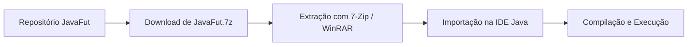

<p align="center">
  
</p>

<p align="center">Projeto de estudo em Java com domínio de futebol, distribuído em arquivo compactado.</p>


<p align="center"><a href="#visão-geral">Visão geral</a> &nbsp;·&nbsp; <a href="#recursos">Recursos</a> &nbsp;·&nbsp; <a href="#como-executar">Como executar</a></p>

<p align="center"></p>

<a id="explore-o-projeto"></a>

## Por onde começar


- **[Pacote](JavaFut.7z)** — Arquivo compactado do projeto Java.
- **[Preparação](README.md)** — Orientações para extrair e abrir o projeto.
- **[Exploração](JavaFut.7z)** — Descompacte para consultar as classes na IDE.


<a id="visão-geral"></a>

## Visão geral

Modelar o domínio do futebol — times, partidas, placares e estatísticas de jogadores — é uma excelente forma de praticar estruturas de dados e orientação a objetos em **Java**. O repositório **JavaFut** preserva o pacote completo do projeto (JavaFut.7z), mantendo a estrutura original de diretórios da IDE pronta para descompactação e importação.

<a id="recursos"></a>

## Recursos

**Domínio esportivo em Java**<br>
Modelagem de entidades e regras inspiradas no gerenciamento de partidas e equipes de futebol.

**Pacote íntegro de projeto**<br>
O arquivo JavaFut.7z preserva a árvore completa de código-fonte e metadados do projeto Java.

**Portabilidade**<br>
Permite extrair e importar diretamente no IntelliJ IDEA, Eclipse, NetBeans ou VS Code.

<a id="tecnologias"></a>

## Tecnologias

- **Java SE** para implementação das regras de negócio e classes do domínio esportivo;
- **Compactação 7z (JavaFut.7z)** para distribuição unificada do workspace.

<details>
<summary>Arquitetura de exploração</summary>



</details>

<details>
<summary>Estrutura do repositório</summary>

```text
JavaFut/
├── assets/
│   └── identity/banner.png               Banner do projeto
├── JavaFut.7z                      Pacote compactado contendo o projeto Java completo
└── README.md
```

</details>

<a id="como-executar"></a>

## Como executar

1. Clone o repositório:
   ```bash
   git clone https://github.com/arthurlynow098/JavaFut.git
   cd JavaFut
   ```
2. Extraia o arquivo JavaFut.7z utilizando o **7-Zip** (7z x JavaFut.7z) ou ferramenta compatível.
3. Abra a pasta extraída na sua IDE Java de preferência, localize a classe com o método public static void main(String[] args) e execute a aplicação.

<p align="center"></p>

<p align="center">
  <a href="https://github.com/arthurlynow098">GitHub</a> &nbsp;·&nbsp;
  <a href="https://arthurentsev.vercel.app/">Portfólio</a> &nbsp;·&nbsp;
  <a href="https://www.linkedin.com/in/entsevarthur/">LinkedIn</a>
</p>
